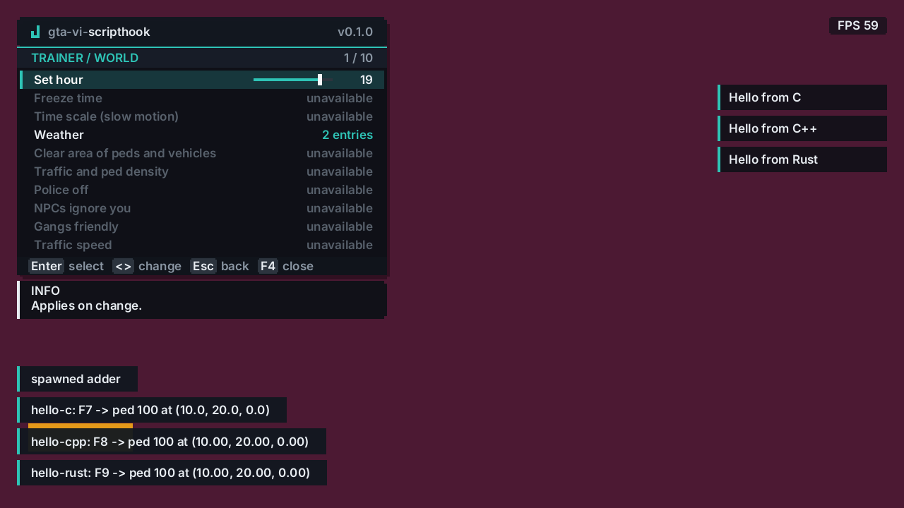
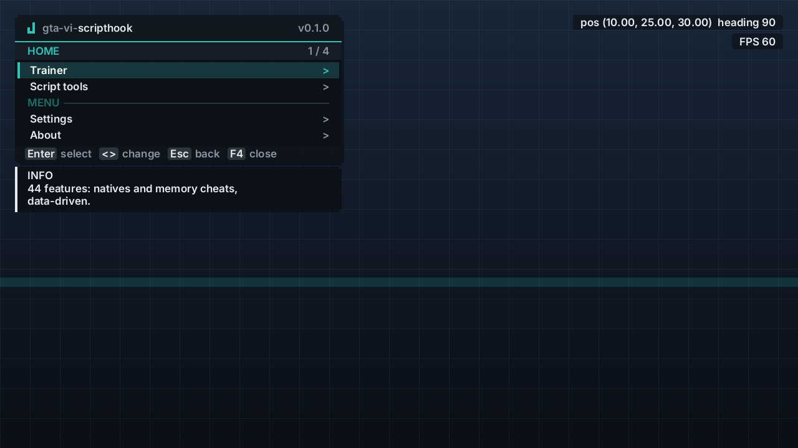
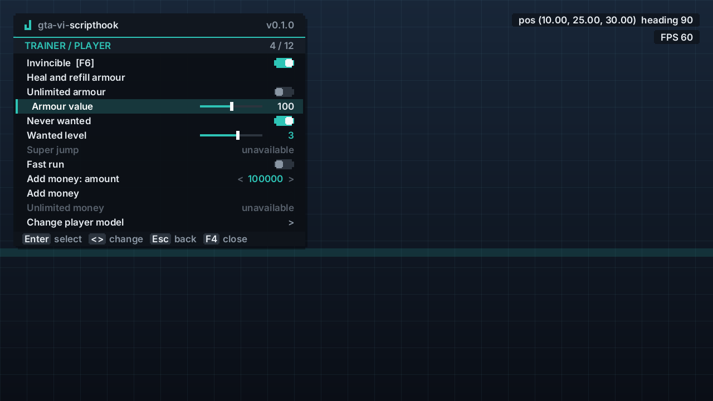
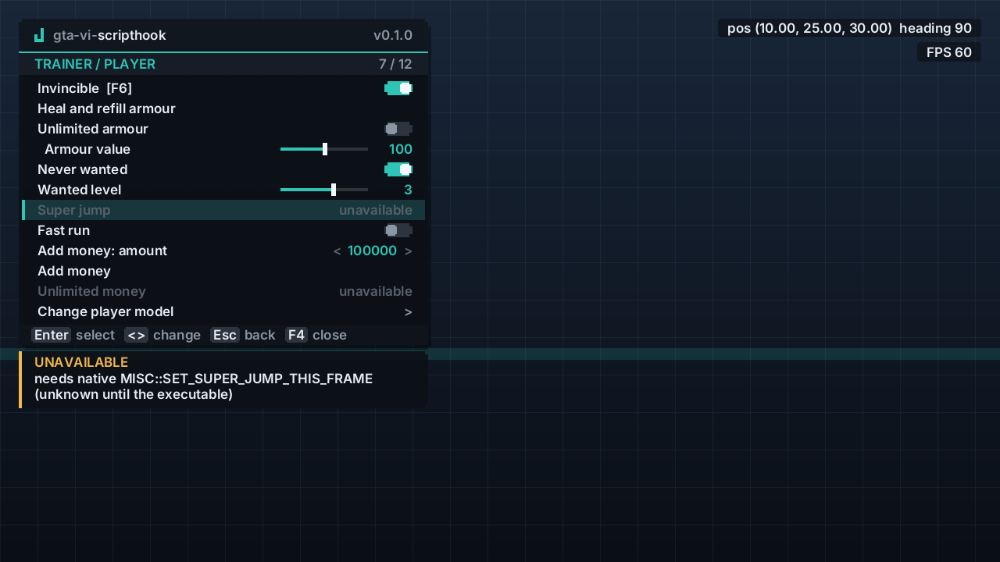
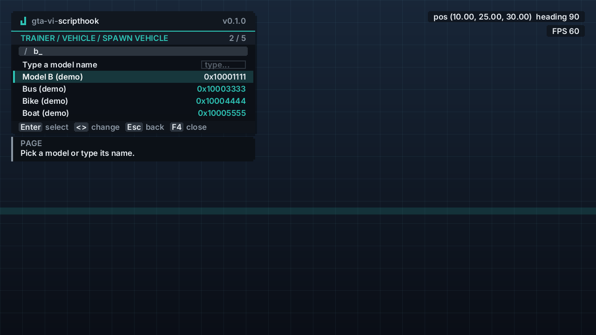

<p align="center">
  <picture>
    <source media="(prefers-color-scheme: dark)" srcset="assets/title-dark.svg">
    
  </picture>
</p>

<p align="center">
  <picture>
    <source media="(prefers-color-scheme: dark)" srcset="assets/icons/discord-dark.svg">
    
  </picture>
  &nbsp;&nbsp;&nbsp;
  <a href="https://github.com/larpingvibecoder"><picture>
    <source media="(prefers-color-scheme: dark)" srcset="assets/icons/github-dark.svg">
    
  </picture></a>
</p>

**gta-vi-scripthook** is a classic script hook for the game on Windows: a DLL that runs inside the
game process and does everything itself. It finds the game's code in memory, locates the natives
(script command) table and the script tick by byte patterns, calls natives with its own call
context, runs script fibers from its own hook of the script tick, draws its overlay by hooking the
DXGI swap chain's `Present` with its own small D3D12 renderer and font, and reads the keyboard and
gamepads itself. Plugins — the mod menu, the trainer, your own scripts — talk to it through a
versioned C ABI, [`scripthook.h`](sdk/include/scripthook.h).

> **Unofficial fan project.** Not affiliated with, authorised or endorsed by Rockstar Games or
> Take-Two Interactive. **Single-player / offline only**: nothing here touches online features or
> services. You need your own legally obtained copy of the game. This repository contains no game
> files and no data taken from the game, and nothing in it bypasses copy protection, anti-cheat,
> licence or integrity checks. *Grand Theft Auto* and related names are trademarks of Take-Two
> Interactive Software, Inc.; they are used here only to say which game the tools are for.

## What is in it

| | |
|---|---|
| **`scripthook.dll`** ([`core/`](core)) | the hook: module and pattern scanning, an x86-64 length decoder and inline hooks with trampolines, natives through the game's own handler table, script fibers on the game's script thread, a D3D12 overlay renderer (Inter font), keyboard and XInput, the plugin loader serving `scripthook.h` |
| **`shk-loader.exe`** ([`loader/`](loader)) | starts your game (or attaches to it) and loads `scripthook.dll` |
| **Plugin SDK** ([`sdk/`](sdk)) | `scripthook.h` (C), `scripthook.hpp` (header-only C++17: RAII, `shk::invoke<T>(name, args...)`, script helpers), the Rust crate `scripthook-sdk` (no external crates) |
| **Natives database** ([`natives/`](natives)) | the `natives.tsv` format and `shk-natives`: checks it, generates `natives.h` / `natives_c.h` / `natives.rs`, imports your copy of public documentation, merges identifiers, verifies table patterns against your executable. The repository ships the format and tools, never data |
| **Mod menu** ([`menu/`](menu)) | a plugin with a clean look: header bar, breadcrumb, switches, sliders, choices, text entry, filterable lists, scroll bar, key hints, description panel, HUD lines; keyboard and gamepad |
| **Trainer** ([`trainer/`](trainer)) | the 44 features (Player, Teleport, Vehicle, Weapons, World, Misc) as data in TOML, on natives and memory cheats; unavailable features are greyed out with the reason |
| **Examples** ([`examples/`](examples)) | hello world in C, C++ and Rust: a notice, a native call, a hotkey |

## Screenshots

The overlay drawn by `scripthook.dll`'s own renderer in the repository's synthetic test target
(a D3D12 window of ours, not the game): the menu on *Trainer / World* after a slider change, the
examples' boxes, notices and the FPS line.



The menu's pages (rendered by the menu's software renderer with the same font):

| | |
|---|---|
|  |  |
|  |  |

## Quick start

Requirements: Windows 10/11 x64 with a D3D12 GPU, Rust (stable), and for the C / C++ examples
Visual Studio 2019+ or the Build Tools with "Desktop development with C++". Nothing is downloaded
by the build.

```powershell
powershell -File tools\package.ps1        # builds everything into dist\gta-vi-scripthook\
```

1. Build your natives database from your own copy of the executable and put it next to
   `scripthook.dll` as `natives.tsv` ([docs/natives-database.md](docs/natives-database.md)). Until
   then the menu works, and the trainer and the examples say which natives they still need.
2. Start the game through the loader (for your own single-player game only):

   ```powershell
   dist\gta-vi-scripthook\shk-loader.exe --launch "<the program that runs the game>" -- <its arguments>
   ```

   When the game runs inside a runtime (Sonoma Runtime or another), launch the runtime: the hook
   finds the game's code in that process by itself. A runtime that loads plugin DLLs from mod
   folders can load `scripthook.dll` directly (`mod.toml` is included) — optional.
3. Press **F4** (keyboard) or **RB + D-pad left** (gamepad) for the menu.

A plugin in Rust:

```rust
use scripthook_sdk::{self as shk, natives::{invoke, Vec3}};

struct Hello;

impl shk::Plugin for Hello {
    fn load(host: shk::Host) -> Result<Self, String> {
        host.notify("Hello from Rust", 4.0);
        host.start_script("hello", || {
            let ped: i32 = invoke("PLAYER::PLAYER_PED_ID", ()).unwrap_or(0);
            let pos: Vec3 = invoke("ENTITY::GET_ENTITY_COORDS", (ped, true)).unwrap_or_default();
            shk::host().info(&format!("player at {pos:?}"));
        });
        Ok(Hello)
    }
}

shk::export_plugin!(Hello, name = "hello", version = "0.1.0", author = "you", description = "says hello");
```

Put the DLL in `plugins\hello\` next to `scripthook.dll`.

## Documentation

| | |
|---|---|
| [Architecture](docs/architecture.md) | the hook, the ABI, threads, the overlay, the menu service, the trainer |
| [Plugin guide](docs/plugin-guide.md) | writing plugins in C, C++ and Rust |
| [Natives database](docs/natives-database.md) | `natives.tsv`, `shk-natives`, building your local database |
| [Menu guide](docs/menu-guide.md) | using the menu, `menu.toml`, adding pages from a plugin |
| [Trainer](docs/trainer.md) | features, statements, memory cheats, trainer data, automation |
| [Building](docs/building.md) | builds, tests, packaging, the loader |
| [FAQ](docs/faq.md) | |
| [Runtimes (optional)](docs/host-integration.md) | loading the hook through a runtime's plugin mechanism, and the older plugin-API adapter |

## Licence

Dual-licensed under [MIT](LICENSE-MIT) or [Apache-2.0](LICENSE-APACHE), at your option;
contributions under the same terms ([CONTRIBUTING.md](CONTRIBUTING.md)). The bundled Inter font
is under the SIL Open Font License 1.1 ([THIRD_PARTY.md](THIRD_PARTY.md)).
